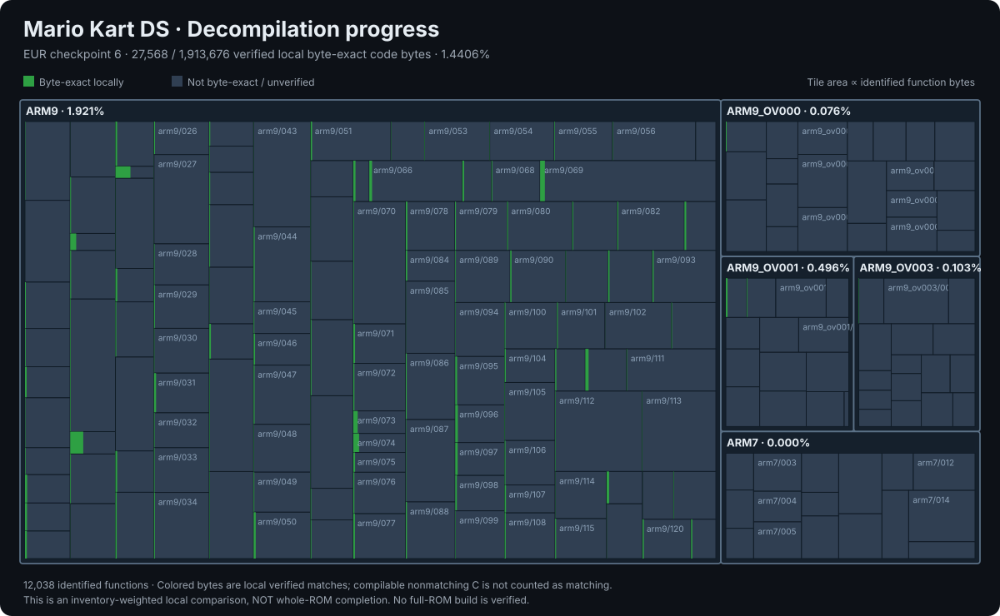

# Mario Kart DS (EUR)

Work-in-progress C decompilation of **Mario Kart DS (Europe)** for Nintendo DS. The project is **not yet a fully rebuildable or playable ROM**.

ROM: game code `AMCP`, SHA-1 `ce97d9b43f0d3ca0d48b781983e8a16f6393378f`.

## Progress

Checkpoint 19: **3,111 locally verified functions, 216,832 inventory bytes (11.330654%)**. This includes 1,396 unrelocated matches and 1,715 matches after resolving all ARM/Thumb relocations. The local 10% target is reached; full-ROM matching remains unverified.

The treemap is weighted by **identified function bytes**, with verified local matches highlighted. Compilation success is **not** evidence of correct behavior or matching assembly. These are local checkpoint measurements, not whole-game completion percentages. See [detailed measurements](reports/MISURA-DECOMP.md) and [GitHub Actions reports](https://github.com/RonyxDumb/mkds/actions/workflows/decomp-report.yml).

You can check it online on [Decomp.dev](https://decomp.dev/RonyxDumb/mkds).

## AI disclosure

**AI-assisted project.** Artificial intelligence has been used to help analyze disassembly, reconstruct C code, resolve compilation issues, and automate verification. AI-generated changes require independent validation; unverified code must not be treated as matching or accurate by default.

## Legal

This repository does not distribute Nintendo ROMs or proprietary game assets. A legally obtained **Mario Kart DS (EUR)** copy is required for reference and verification.
