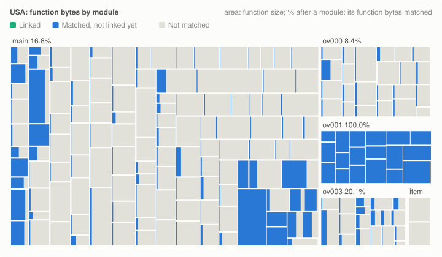
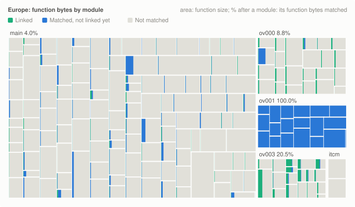

# Mario Kart DS decompilation

A matching decompilation of *Mario Kart DS* for the Nintendo DS. The C in this repository is written with AI
assistance so that, built with the original compiler, it reproduces the game's code byte for byte.

**No game content is included.** The repository holds no ROM, no assets and no disassembly. To build, you need your
own dump of the game; see [INSTALL.md](INSTALL.md).

| Version | Game code | SHA-1 |
| --- | --- | --- |
| USA | `AMCE` | `691e00d9a5dd80b04f80cc7559503e8b06848785` |
| Europe | `AMCP` | `ce97d9b43f0d3ca0d48b781983e8a16f6393378f` |

Every function is decompiled from the game's own code. Code from other decompilations is not accepted.

## Progress
Each version's section is recorded from a build of that version (`python3 tools/configure.py <ver>`):
`ninja report && python3 tools/progress.py update`.

### USA
<!-- progress:usa:start -->

| Measure | Progress |
|---|---|
| Matched code | 9.28% (175,048 / 1,886,100 bytes) |
| Linked code (complete units) | 0.00% (0 bytes) |
| Overall accuracy (fuzzy) | 10.65% |
| Matched functions | 2,374 / 11,501 |

_Last updated 2026-10-25. Over time: [graph](progress/usa/progress.svg), [`progress/usa/history.csv`](progress/usa/history.csv)._
<!-- progress:usa:end -->

### Europe
<!-- progress:eur:start -->

| Measure | Progress |
|---|---|
| Matched code | 3.69% (69,612 / 1,886,120 bytes) |
| Linked code (complete units) | 0.00% (0 bytes) |
| Overall accuracy (fuzzy) | 4.74% |
| Matched functions | 1,760 / 11,501 |

_Last updated 2026-10-25. Over time: [graph](progress/eur/progress.svg), [`progress/eur/history.csv`](progress/eur/history.csv)._
<!-- progress:eur:end -->

## Documentation
- [INSTALL.md](INSTALL.md): setting up and building
- [CONTRIBUTING.md](CONTRIBUTING.md): repository layout, naming and workflow
- [docs/compiler.md](docs/compiler.md): how the compiler and flags were identified
- [docs/decompiling.md](docs/decompiling.md): source patterns that matter for matching

Built with [ds-decomp](https://github.com/AetiasHax/ds-decomp), Metrowerks CodeWarrior for DS run through
[wibo](https://github.com/decompals/wibo), and [objdiff](https://github.com/encounter/objdiff).
