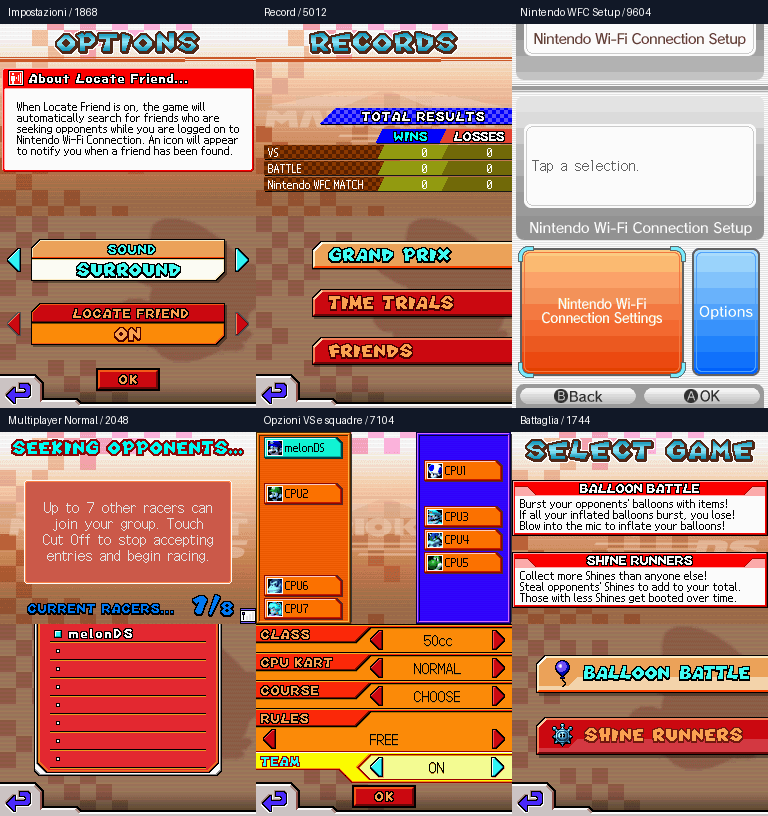

# Mario Kart DS — menu esplorati il 15 ottobre 2026

Esplorazione guidata della **ROM EUR di riferimento**, con profilo iniziale
vuoto nell'emulatore. **45.482 frame in tre sessioni**, con 537 coppie di
snapshot ai confini dei blocchi di input. Non è una dimostrazione di una ROM ricostruita interamente
dal C. Il nuovo matching verificato è nel [checkpoint 26](CHECKPOINT-26.md).



| Area | Schermate e controlli osservati |
|---|---|
| Opzioni → Impostazioni | Surround, Stereo, Headphones; Locate Friend ON/OFF |
| Opzioni → Modifica | Nickname; tastiere base, accenti, giapponese, simboli e icone; editor emblema Paint, Camera e menu di uscita |
| Cancellazione | Conferma di cancellazione generale e del record individuale; annullate, senza confermare l'eliminazione |
| Record | Totali; coppe Mushroom, Flower, Shell, Banana; pagine di 16 circuiti Prove a tempo; messaggio per lista amici vuota |
| Nintendo WFC | Menu Match/Friend Code/Settings; informazioni di primo utilizzo; nessun codice amico ancora generato; tentativo di connessione e messaggi di errore |
| WFC Setup | Opzioni, informazioni del DS virtuale, slot di connessione, configurazione manuale, tastiere SSID/WEP/IP, istruzioni USB Connector |
| Ricerca Wi-Fi | Ricerca e rilevamento dell'access point virtuale `melonAP`; istruzioni AOSS e successivo ritorno al menu dopo annullamento |
| Multiplayer | Ricerca gruppi, creazione gruppo, scelta Normal/Simple e lobby dopo entrambe le selezioni; un solo partecipante |
| Gran Premio | Classi, personaggi, kart, coppe e conferma; Figure-8 Circuit; pausa Continue/Quit |
| VS | Classi 50/100/150 cc; CPU Easy/Normal/Hard; Choose/In Order/Random; Free/Wins/Races, relativi valori e squadre ON; scelta coppa/circuito |
| Battaglia | Balloon Battle e Shine Runners; impostazioni; anteprime delle sei arene |
| Missioni | Selezione livelli; istruzioni 1-1–1-8; conferma; missione 1-1; pausa e fallimento deliberato per timeout; menu Retry/Select Mission/Quit |
| Prove a tempo | Sottomenu; personaggio, kart, coppa, circuito e conferma; gara; pausa Continue/Restart/Change Course/Change Character/Quit |
| Ghost | Send Ghost: nessun dato disponibile; Receive Ghost: selezione host vuota, senza trasferimento |

Pannelli aggiuntivi: [record e circuiti](../docs/menus/record-courses.png),
[impostazioni VS](../docs/menus/vs-settings.png),
[otto briefing missioni](../docs/menus/mission-briefings.png),
[pause, fallimento e ghost](../docs/menus/pause-ghost.png).

## Limiti osservati

Nel profilo iniziale sono selezionabili quattro coppe e sedici circuiti:
la navigazione Record è stata seguita fino al ritorno alle pagine iniziali.
I tentativi sui livelli missione 2–6 non li aprono; il boss non è stato aperto (silhouette nel menu). Non sono stati
completati coppe, missioni o sblocchi, né raggiunti podi, crediti o tutti i
risultati possibili. Non dichiarare esplorato l'intero gioco.

Il frontend ha backend rete/multiplayer disattivati: la rilevazione di `melonAP`
è interna all'emulatore. Il tentativo Nintendo WFC termina con “Unable to
connect” e l'invito a controllare l'access point. Non dimostra una connessione
Internet, un abbinamento online o una partita con altri dispositivi. AOSS ha
richiesto ulteriore avanzamento prima del ritorno al menu dopo annullamento.

## Evidenza e riproduzione

`MENU-EXPLORATION-2026-10-15.json` conserva hash della ROM e del frontend,
frame conclusivi, input, hash dei framebuffer e osservazioni etichettate.
I frame non corrispondono al numero di menu distinti: il percorso contiene
attese, pagine ripetute, transizioni e tentativi di navigazione.

Il core è melonDS `906e9ebb27da8c6a715cd7abab4abfe8a8d29427`.
La nuova modalità `--interactive` accetta blocchi limitati di frame e registra
automaticamente gli input. Un comando di durata zero è stato rifiutato.
Il replay iniziale di 1.744 frame produce framebuffer **identici su entrambi
gli schermi** alla sessione guidata. Non è un confronto fra ROM originale e build C,
né una verifica di riproducibilità dell'intera sequenza di rete.

Esempio, dopo aver costruito il frontend con `scripts/build_headless_emulator.sh`:

```sh
tools/melonds-headless /percorso/AMCP.nds 19854 build/menu-replay \
  --inputs scripts/inputs/menu-options-records-wfc.tsv --capture-every 600
```

Gli altri percorsi sono in `scripts/inputs/menu-multiplayer-vs.tsv` e
`scripts/inputs/menu-battle-missions-time-trials.tsv`. Lo snapshot del core e
gli input permettono di ripetere le osservazioni usando la propria ROM EUR.
